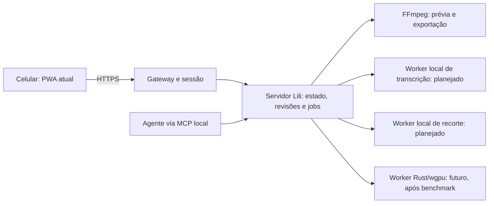

# Proposta de evolução local e automação — revisão de 02/11/2026

## Decisão de produto

A especificação enviada pelo usuário é referência para acelerar a Lili, não autorização para descartar o editor existente ou copiar código copyleft. Priorizar automações simples no celular, processamento no PC, modelos locais com licença compatível e controle manual opcional. A timeline permanece em Ajustes finos: ela já foi solicitada e permite conservar o estilo da Elisa após a primeira montagem.

A aplicação deve manter código fechado. Fronteira entre pastas/processos, monorepo, JSON-RPC e MCP não criam dispensa de licença. Não reutilizar módulos/shaders/wrappers AGPL do Concat. Conferir bibliotecas, bindings, builds, modelos, fontes e materiais separadamente antes da distribuição.

## Base existente e proposta aproveitável

| Área | Situação atual verificada no repositório | Evolução proposta |
| --- | --- | --- |
| Interface no celular | Web/PWA responsiva em web/, editor manual e inicial | Flutter definido para o app móvel; fluxo guiado de importar, prévia, ajustar e exportar; PWA atual durante a transição |
| Estado e edição | Python em lili/, revisão, comandos e histórico | Continuar fonte única de estado; automações geram operações reversíveis, sem escrever projetos por conta própria |
| Processamento | FFmpeg, jobs, prévia/exportação, fontes preservadas | Worker opcional por tarefa e benchmark; não reimplementar codecs antes de entregar funções |
| Upload | Upload em partes, validação, cancelamento e processamento no PC | Reaproveitar recebimento e recuperação; arquivo disponibilizado por ID, sem caminho arbitrário vindo do celular |
| Acesso | Gateway autenticado, portal/conector e túnel existentes | Preservar entrada única HTTPS; isolamento individual continua pendente da integração já documentada |
| Automação por agente | MCP local em lili/mcp.py e chat com Codex | Manter MCP para agentes; app usa API autenticada/jobs existentes; IA local é provedor adicional ainda não implementado |
| Rust/GPU/ONNX | Toolchain cargo/rustc não encontrada no PATH consultado; sem worker Rust implementado | Acrescentar só após função/benchmark justificar; não tratar dependência escolhida como recurso ativo |

## Correções técnicas da especificação

1. **Separação não é exceção automática de licenciamento.** O limite depende da composição e distribuição real, não de chamar uma camada de API. A organização em core/app pode ser útil para manutenção, mas não aprova código AGPL/GPL embutido em produto fechado.
2. **wgpu não substitui codecs.** É biblioteca gráfica/compute; shaders podem fazer composição/filtros. FFmpeg e codecs ainda cuidam de decodificar, codificar e muxar, com cópia de frames, sincronismo, formato de pixel/HDR e memória a medir. Usar wgpu não garante utilizar toda a GPU nem acelerar todo o pipeline. Começar comparando o render atual e encoders de hardware com fallback, sem trocar automaticamente a saída dos projetos reais.
3. **whisper.cpp não é modelo ONNX.** É implementação de inferência em C/C++; pode ser executada como worker local com modelo compatível. Whisper via ONNX Runtime é outro caminho, com export/modelo e backend próprios. Escolher um para o primeiro resultado reduz dependências. Timestamps por palavra do whisper.cpp são documentados como experimentais: validar em português, silêncio, ruído e voz rápida antes de prometer sincronismo perfeito. Transcrever não implementa sozinho a animação visual das legendas.
4. **RVM não é escolha neutra para código fechado.** O repositório oficial declara GPL-3.0 e tem foco em matting de pessoas. Não será incorporado como módulo sob pressuposto de licença permissiva; código, pesos e forma de distribuição exigem avaliação. Para gatos/objetos como a Cora, não assumir que um modelo voltado a humanos resolve o recorte.
5. **SAM 2 é candidato, não integração pronta.** Projeto/checkpoints oficiais declaram Apache-2.0, com componentes adicionais que conservam suas licenças. O fluxo oficial usa PyTorch, prompts e propagação de máscaras no vídeo; não é simplesmente entregar qualquer arquivo SAM 2 ao ONNX Runtime. Conversão, operadores, memória temporal, refinamento de bordas e desempenho precisam de prova. Segmentação não equivale automaticamente a matting fino de pelos/cabelos ou remoção universal em um clique.
6. **MCP não é o canal de upload nem autenticação do app.** Usa JSON-RPC e transportes definidos; não basta escutar um objeto action numa porta pública. O app já pode pedir ações por HTTPS e acompanhar um job. MCP continua adaptador para agentes, sem duplicar o estado, sem expor ferramentas arbitrárias do PC pela internet.
7. **Inferência local e edição semântica são tarefas distintas.** Whisper fornece fala; recorte fornece máscara. Escolher os melhores planos e conservar o estilo da Elisa exige regras/perfil e, se necessário, um planejador local avaliado separadamente. O chat atual usa Codex externo: não anunciar a Lili inteira como offline ou sem consumo da conta enquanto esse modo estiver selecionado.
8. **Privacidade precisa descrever o tráfego real.** Render/modelos podem permanecer no PC, mas acesso remoto depende de internet/túnel e seu intermediário. Um modo local sem IA externa deve impedir explicitamente envio ao Codex/API; funcionar offline significa também dispor dos modelos instalados. Não confundir ausência de cobrança por chamada com ausência de custos de armazenamento/hardware/energia.

## Arquitetura incremental proposta

Manter lili/ e web/ funcionando. Uma futura organização core/ e app/ pode separar workers e um aplicativo nativo, mas a migração de diretórios não deve anteceder nem bloquear recursos úteis. Criar contratos versionados antes de criar outro serviço. Nenhuma porta nova precisa ser exposta: workers podem falar por stdio/IPC ou loopback restrito, controlados pelo servidor.

O servidor continua dono da revisão e dos caminhos. Workers recebem somente os artefatos autorizados para o trabalho, produzem resultados na pasta temporária do job e não alteram credenciais, compartilhamento, mídia original ou project.json. Aplicação ao projeto acontece no servidor após validar o resultado e a revisão. Um JSON de modelo ou conteúdo do vídeo nunca autoriza shell/comando externo.

## Ordem de execução recomendada

### A — Automação útil sobre a base atual

Criar central de ações com rótulos específicos e honestos: Cortar pausas da fala, Gerar legendas, Suavizar transições, Preparar exportação. Mostrar botão acionável apenas para capacidade testada/ativa. Não colocar um Limpar vídeo genérico que mude corte, voz e imagem sem explicar o efeito. Reutilizar atalhos de transições já existentes.

Cada ação precisa ter estimativa/etapas, cancelar onde suportado, prévia, aplicar/descartar e Desfazer. Guardar montagem anterior e respeitar cenas/sons protegidos. Para a Elisa, considerar dois fluxos: gravações com fala original e vlog montado antes de gravar narração; não cortar b-roll por silêncio automaticamente no segundo caso.

Critérios: uma operação lógica no histórico; revisão divergente preserva o trabalho atual; falha/cancelamento não aplica metade da montagem; imagem/voz/legendas ficam sincronizadas; original e último take aprovado preservados. Primeiro marco é uma ação completa, não uma tela com botões de capacidades inexistentes.

### B — Transcrição local e legendas

Primeiro protótipo sugerido: whisper.cpp upstream, instalação/modelo de origem e licença verificadas, sem copiar integração Concat. Medir CPU/GPU, RAM, português, fala curta/longa, ruído e arquivo sem voz. Modelo não instalado deve resultar em capacidade indisponível, sem baixar arquivos grandes silenciosamente ou recorrer a API externa.

Produzir transcrição com intervalos da fonte e mapear para a montagem: entrada/saída, velocidade e offset dos blocos independentes devem ser considerados. Permitir corrigir texto/tempo. Começar por legendas estáticas já suportadas; depois tokens/palavras e realce animado, com renderização equivalente na prévia/exportação. Persistir formatos versionados, sem substituir o projeto real durante teste.

### C — Cortar pausas, com revisão

Distinguir silêncio medido (dBFS + duração mínima) de voz detectada por VAD. Evitar threshold:0.8 sem unidade/semântica. Parâmetros propostos, ainda não implementados: silence_db, min_silence_seconds, speech_padding_seconds e fontes elegíveis. Proteger respirações naturais, hesitações desejadas e b-roll; dar prévia de antes/depois. Usar intervalos da fonte e transformar áudio/legendas vinculados com a mesma regra, preservando outros sons independentes. Não generalizar que silêncio é erro de edição.

### D — Recorte assistido local

Avaliar SAM 2 com checkpoint oficial compatível, export quando aplicável e licença completa do caminho escolhido. Começar por uma seleção de objeto por toque/caixa, propagação em vídeo curto e revisão de máscara; testar humano, gato, movimento, oclusão e pelos. Resolução reduzida/proxy é opção explícita; medir tempo, RAM/VRAM e resultado em 1080p antes de prometer processamento fluido/4K. Sem fallback para serviço externo.

### E — Aceleração e eventual worker Rust

Medir gargalo real antes da migração. Teste sintético compara render atual, encoder por hardware e, se necessário, um filtro/compositor wgpu. Identificar GPU/driver, memória realmente disponível, formatos suportados e caminhos de cópia. Encoder compilado não prova encoder operacional; existência de placa NVIDIA não prova que um modelo cabe na VRAM.

Só introduzir Rust onde houver benefício medido em desempenho, estabilidade ou distribuição. Preservar fallback CPU/FFmpeg e contrato de jobs. O ganho deve ser verificado com qualidade/pixels, duração, sincronismo, cancelamento, recuperação e memória, não apenas FPS de uma demonstração de terceiros.

### F — Aplicativo móvel em Flutter — tecnologia definida pelo usuário

Decisão explícita do usuário em 02/11/2026: desenvolver a versão para celular em **Flutter**. Esta escolha substitui a comparação anterior com Expo/React Native. Registrar a decisão agora; não iniciar migração ou instalação de toolchain apenas por este registro. O acesso web/PWA existente permanece disponível durante a transição futura. O aplicativo Flutter deve reaproveitar as APIs, autenticação, projetos, revisões e jobs do servidor; processamento pesado continua no motor local previsto. Manter regras no servidor para evitar divergência entre interfaces. Flutter não muda automaticamente o motor nem as obrigações de licença.

## Contratos e segurança a preservar

- API versionada/capacidades: provedores instalados, modelo/hash/versão, tipos de ação e limites; sem anunciar transcrição/recorte/GPU como ativos nesta proposta.
- Trabalho: IDs de projeto e mídias, expected_revision, parâmetros tipados, chave de idempotência e contexto de autorização definido no servidor. Resposta com job_id; estados de fila, execução, conclusão, erro e cancelamento precisam refletir suporte real por tarefa.
- Artefatos: upload existente em partes, tamanho/hash, saída identificada por job/artefato, diretório isolado; não aceitar caminho livre nem URL de modelo trazida por navegador/modelo. Download sujeito à autorização do projeto.
- Modelos: manifesto com origem, licença, versão e SHA-256; dependências/bindings e aceleração auditados; instalação explícita e falha previsível, sem token/segredo em logs.
- Não expor MCP/worker cru, confiar em headers de usuário vindos do celular ou assumir que contas individuais já estão integradas. Portal/túnel/sessões permanecem os atuais; contas reais seguem na frente específica de segurança.

## Verificações desta revisão e limitações

Inspecionados módulos existentes, requisitos Python, interface MCP e comandos locais disponíveis. Rust não encontrado no PATH consultado. Consultado inventário de GPU/RAM somente para orientar viabilidade, sem benchmark, leitura de mídia pessoal ou execução de IA.

O FFmpeg instalado informou versão 7.1 e build com enable-gpl; nonfree não habilitado. Também anunciou encoders de hardware compilados. Não foram testados drivers/encoders, comparada qualidade ou atestada licença de toda a distribuição. Não concluir que o código próprio da Lili se tornou GPL por executar esse binário, nem prometer redistribuição irrestrita; a composição/executável e seus deveres precisam ser verificados na distribuição comercial.

Esta entrega registra análise e esteira. Não instalou Rust, modelos, ONNX ou novos serviços; não criou app nativo, worker GPU, transcrição ou recorte. Sem alteração de código, serviços, sessões ou projetos reais. Revisão de diff/documentação; não há nova suíte funcional a alegar para uma proposta arquitetural. Não conta como rodada automática de edição ou segurança.

## Fontes primárias consultadas em 02/11/2026

- [wgpu: escopo gráfico/compute e backends](https://wgpu.rs/).
- [whisper.cpp: implementação e timestamps por palavra experimentais](https://github.com/ggml-org/whisper.cpp), [licença MIT](https://github.com/ggml-org/whisper.cpp/blob/master/LICENSE).
- [ONNX Runtime: execution providers](https://onnxruntime.ai/docs/execution-providers/).
- [RVM: foco humano e GPL-3.0](https://github.com/PeterL1n/RobustVideoMatting), [licença](https://github.com/PeterL1n/RobustVideoMatting/blob/master/LICENSE).
- [SAM 2: fluxo de inferência, checkpoints e licenças](https://github.com/facebookresearch/sam2), [Apache-2.0](https://github.com/facebookresearch/sam2/blob/main/LICENSE).
- [MCP: transportes](https://modelcontextprotocol.io/specification/2025-11-25/basic/transports), [segurança](https://modelcontextprotocol.io/docs/2025-11-25/tutorials/security/security_best_practices).
- [GNU FAQ: separação/combinação de programas](https://www.gnu.org/licenses/gpl-faq.en.html#MereAggregation).
- [FFmpeg: licença e componentes opcionais](https://ffmpeg.org/doxygen/trunk/md_LICENSE.html).
